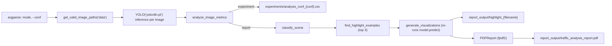

# TrafficAnalyzer: documentation hub

TrafficAnalyzer is a single Python module (`traffic_analyzer.py`) that runs the YOLOv8n object detector over still images in `data/`, counts the detections of the COCO classes `car` and `truck`, and computes per-image metrics (vehicle count, summed box area relative to image area, average box area). In `experiment` mode it writes those metrics to a CSV file; in `report` mode it also assigns each image one of five scene types and builds a PDF report in Russian with three annotated example images. It is run, tested and packaged through `recipe.ps1`, with the toolchain pinned in `pyproject.toml` and `uv.lock`. The intended users are not stated in the repository (see [Open questions in SPEC.md](../SPEC.md#9-open-questions)).

## 1. Status

| Item | State | Source |
|---|---|---|
| Written from | `9027764`, 2026-11-17, "docs(spec): add SPEC.md mirrored as Jira KAN-58", branch `ta-58/docs/spec-md` | `git log -1` |
| Base | `origin/test` at `1ea51d9`, 2026-11-07, "docs(docs): changelog for v1.0.0"; this branch adds one commit to it | `git log origin/test..HEAD` |
| History on this branch | 25 commits (18 without merges), 2026-02-23 to 2026-11-17 | `git rev-list --count` |
| Version | `1.0.0`; the tag `v1.0.0` is on the `release` merge `434c0f1`, which is not in this branch's history | `recipe.ps1:13`, `pyproject.toml:16`, `git tag` |
| Tests | 6 files in `tests/` with 6 test functions: 4 in the five tool-test files, which test copies of the functions, not the module (section 7), and 2 in `tests/test_manual_list.py` | `tests/*.py` |
| Manual tests | None listed | `tests/manual/tests.json:3` |
| Coverage floor | 0 | `pyproject.toml:74-75` |
| CI | Five Gitea workflows: `propose`, `test`, `release-gate`, `release`, `sweep`; their runs were not checked | `.gitea/workflows/` |
| TODO / FIXME markers | 0 in `*.py` and `*.md`, apart from `tools/wiki.py`, where `@todo` is a tag the wiki generator collects | `git grep -n -i -E 'TODO\|FIXME\|XXX\|HACK'` |
| Licence | MIT | `LICENSE:1`, `pyproject.toml:19` |
| Open tasks | Jira KAN-58, listed in SPEC.md | [section 3.8 of SPEC.md](../SPEC.md#38-declared-but-not-implemented) |

Evidently unfinished at this commit:

- `tests/test_generate_visualizations.py` contains no `test_` function, only a copy of an earlier `__main__` block (`tests/test_generate_visualizations.py:146-235`); `generate_visualizations` has no test.
- The tests do not import `traffic_analyzer.py` (`README.md:22` says so too); each test file carries its own copy of the functions, and three of those copies differ from the module: `analyze_image_metrics` in `tests/test_analyze_image_metrics.py` and in `tests/test_classify_scene.py`, and `generate_visualizations` in `tests/test_generate_visualizations.py` (section 7).
- The docstring of `find_highlight_examples` describes selection "per each criterion" (`traffic_analyzer.py:80`), the code sorts by one combined key (`traffic_analyzer.py:90`).
- `tests/manual/tests.json` lists no manual test, so the release gate records the manual round as "no manual tests defined" (`.gitea/workflows/release-gate.yaml:139-149`).

Branch note. This checkout is branch `ta-58/docs/spec-md`: `origin/test` (`1ea51d9`) plus commit `9027764`, which adds the first `SPEC.md`. `origin/release` (`434c0f1`, tag `v1.0.0`) has the same tree without `CHANGELOG.md` and `SPEC.md`; `CHANGELOG.md` was committed to `test` a minute after that merge. `origin/dev` (`37240bf`, 2026-02-24) and `origin/main` (`fe45e68`, 2026-08-05, adds the MIT `LICENSE`) are both ancestors of this branch. The remote default branch (`origin/HEAD`) is `release` (`git log`, `git diff --stat HEAD origin/release`, `git merge-base --is-ancestor`, `git symbolic-ref refs/remotes/origin/HEAD`). This hub and [../SPEC.md](../SPEC.md) describe commit `9027764`.

## 2. Layout

| Path | Content |
|---|---|
| `traffic_analyzer.py` | The whole program: image discovery, metrics, scene classification, highlight selection, annotation, `PDFReport` class, CLI (335 lines) |
| `pyproject.toml` | Project metadata (version `1.0.0`, Python `>=3.12,<3.13`), seven pinned runtime and five pinned development dependencies, and the settings of pytest, coverage, mypy and ruff |
| `uv.lock` | Locked environment for Python 3.12 (66 package entries) |
| `recipe.ps1` | Project constants (name, code, version, summary, commit and branch vocabulary, reviewers) and the verbs `build`, `install`, `uninstall`, `clean`, `run`, `publish`, `info`, `test` |
| `README.md` | Project README: purpose, use, layout, licence, lab compliance line |
| `docs/install.md`, `docs/manual.md` | Installation (uv, Python 3.12, Git LFS) and the operator manual (modes, CSV columns, scene rules) |
| `SPEC.md` | Requirements specification and the task list mirrored as Jira KAN-58 |
| `CHANGELOG.md` | Entry for v1.0.0 (2026-11-07): commits, issues, pull requests |
| `CONTRIBUTING.md` | Contribution steps: issue, branch from `test`, `recipe.ps1 test`, commit, pull request |
| `CLAUDE.md` | Repository rules for work with Claude Code: branches, commits, keys, language, the gate, merges into `test` and `release` |
| `LICENSE` | MIT |
| `data/` | 27 input images (`11.png`, `22.png`, `33.png`, `img1.jpg` ... `img24.png`, one of them `img2.jpeg`) plus two non-image files, `txtfile` and `webmfile.webm`, which the extension filter skips |
| `experiments/` | CSV outputs of earlier `experiment` runs at `--conf` 0.25, 0.45, 0.5, 0.7 (27 rows each) |
| `report_output/` | Output of an earlier `report` run: `traffic_analysis_report.pdf` (4 pages) and `highlight_11.png`, `highlight_22.png`, `highlight_33.png` |
| `tests/` | `test_*.py` files, `test_sandbox/` with fixtures `11.jpg`, `22.PNG`, `img1.zip`, and `manual/` with the manual test list `tests.json`, the page `index.html` and its local server `serve.py` |
| `tools/wiki.py` | Wiki generator from docstrings and tag comments, vendored from another lab repository (`tools/wiki.py:1`); run by the `test` workflow |
| `ttf/` | `DejaVuSans.ttf`, `DejaVuSans-Bold.ttf`, used for Cyrillic text in the PDF |
| `.gitea/` | Five workflows and the issue and pull request templates |
| `.claude/` | Claude Code settings and hooks (command gate, event log, session log), the git hooks `commit-msg` and `pre-push`, and the skill `lab-ai-env` |
| `.vscode/` | `launch.json`: debug configuration "Python Debugger: Current File with Arguments" (prompts for arguments); `settings.json`: excludes `**/target` from the file watcher |
| `.gitignore` | Build output and tool caches, `.venv/`, `.claude/logs/`, `.claude/settings.local.json`, `.claude/.env`, `*.pt` (model weights), `.env`, `*.egg-info/` |
| `.gitattributes` | LF line endings (CRLF for `.ps1`, `.bat`, `.cmd`); PDF, PNG, JPG, ZIP and 7z files in Git LFS |

## 3. Architecture

All components are functions in `traffic_analyzer.py`; the `__main__` block (`traffic_analyzer.py:215-335`) wires them per mode. `.\recipe.ps1 run` starts it in the locked environment (`recipe.ps1:60-63`).



Data flow:

1. `get_valid_image_paths` lists `data/` in sorted order, keeps `.jpg`/`.jpeg`/`.png` (any case) that OpenCV can decode (`traffic_analyzer.py:13-29`).
2. Each image is read with OpenCV and passed to the YOLO model with `conf=--conf`, `verbose=False` (`traffic_analyzer.py:246-249`, `287-289`).
3. `analyze_image_metrics` turns the detections into a dict: `total_vehicles`, `density`, `avg_bbox_area`, `car`, `truck` (`traffic_analyzer.py:32-73`); the main block adds `filename` and, in report mode, `scene_type`.
4. Experiment mode writes all dicts to CSV (`traffic_analyzer.py:259-266`).
5. Report mode: `classify_scene` (`traffic_analyzer.py:125-146`), `find_highlight_examples` (`76-92`), `generate_visualizations` (`95-122`), then `PDFReport` (`149-212`) assembles the PDF (`304-333`).

External dependencies: the ultralytics YOLOv8 library and the weights file `yolov8n.pt`, which is not in the repository (`.gitignore:27`). `docs/install.md:7` states that the first run downloads `yolov8n.pt` into the working folder, so it needs a network connection, and that `.\recipe.ps1 test` needs it too; not verified here. The code makes no network calls of its own and passes no `device` argument to the model (`traffic_analyzer.py:249`, `289`), so CPU or GPU choice is left to ultralytics and torch defaults (inference).

## 4. Build and run

Prerequisites (`docs/install.md:3-5`):

- uv and Python 3.12. Python 3.13 will not do: the pinned `torch` and `numpy` have no Windows wheels for it (`docs/install.md:3`, `pyproject.toml:20-22`).
- Git LFS, because the images and PDFs are stored in it (`docs/install.md:4`).
- Packages, pinned in `pyproject.toml:23-31` and locked in `uv.lock`: `torch==2.5.1`, `torchvision==0.20.1`, `ultralytics==8.0.196`, `opencv-python==4.8.1.78`, `tqdm==4.66.1`, `numpy==1.26.0`, `fpdf2==2.7.6`; development group `ruff==0.16.1`, `mypy==2.3.0`, `pytest==8.4.2`, `pytest-cov==5.0.0`, `coverage==7.15.2` (`pyproject.toml:36-42`).
- Optional: the two DejaVu fonts in `ttf/` (present in the repository).

Install, at the repository root (source: `docs/install.md:5`):

```powershell
uv sync --frozen
```

Run, from the repository root, because all paths in the code are relative (source: `README.md:12-13`, `docs/manual.md:4`):

```powershell
.\recipe.ps1 run <mode> [--conf <threshold>]
.\recipe.ps1 run report --conf 0.45
.\recipe.ps1 run experiment --conf 0.45
```

`run` calls `uv run --frozen python traffic_analyzer.py` with the same arguments (`recipe.ps1:61`).

Build and publish:

```powershell
.\recipe.ps1 build
.\recipe.ps1 publish
```

`build` writes a wheel that carries only the module to `dist\` (`recipe.ps1:49`, `pyproject.toml:46`); installed that way it runs as `python -m traffic_analyzer` and reads `data/` from the folder it is started in (`docs/install.md:9`). `publish` needs `LAB_SHARE` and copies the wheel to `$env:LAB_SHARE\needs\traffic-analyzer\v1.0.0` (`recipe.ps1:64-73`). `clean` removes `dist`, `build`, `out` and `.coverage`; `info` prints the project constants; `install` and `uninstall` do nothing (`recipe.ps1:52-59`, `74-81`).

## 5. Configuration

The program reads no environment variables and no configuration files. Its only run-time settings are CLI arguments (`traffic_analyzer.py:220-229`):

| Argument | Meaning | Default |
|---|---|---|
| `mode` (positional) | `experiment` or `report` | required |
| `--conf` | Detection confidence threshold passed to YOLO; type `float`, range not checked | `0.45` |

Values fixed in code:

| Name | Value | Source |
|---|---|---|
| Input directory | `data` | `traffic_analyzer.py:238`, `278` |
| Model weights | `yolov8n.pt` in the working directory | `traffic_analyzer.py:240`, `281` |
| `TARGET_CLASSES` | `["car", "truck"]` | `traffic_analyzer.py:236`, `277` |
| `THRESHOLDS` (report mode) | `jam_count` 10, `jam_density` 0.3, `heavy_count` 5, `single_density` 0.15 | `traffic_analyzer.py:271-276` |
| Highlight count `top_n` | 3 | `traffic_analyzer.py:76`, `301` |
| Experiment output | `experiments/analysis_conf_{conf}.csv` | `traffic_analyzer.py:260-261` |
| Report output | `report_output/` (`highlight_{filename}`, `traffic_analysis_report.pdf`) | `traffic_analyzer.py:279`, `109`, `332` |
| PDF fonts | `ttf/DejaVuSans.ttf`, `ttf/DejaVuSans-Bold.ttf`; family `Arial` if either is missing | `traffic_analyzer.py:154-164` |

Tooling configuration:

| Where | What it sets | Source |
|---|---|---|
| `pyproject.toml` | ruff version, rules and format (`52-69`), pytest options and coverage floor (`71-81`), mypy files and the three silenced third-party imports (`83-92`) | `pyproject.toml` |
| `recipe.ps1` | Name, code, version, summary, commit and branch vocabulary, reviewers | `recipe.ps1:11-25` |
| `.claude/.env` | Not in the repository (gitignored); the recipe loads its `NAME=value` lines into variables not already set | `recipe.ps1:34-43`, `.gitignore:24` |
| `LAB_SHARE` | Target folder of `publish` | `recipe.ps1:66-69` |
| `.claude/settings.json` | `PYTHONIOENCODING`, `PYTHONUTF8`, `MSYS_NO_PATHCONV` and the hooks for Claude Code sessions | `.claude/settings.json` |

## 6. Usage

Collect metrics at several thresholds and compare them (this is how the four files in `experiments/` were evidently produced; inference from their names):

```powershell
.\recipe.ps1 run experiment --conf 0.25
.\recipe.ps1 run experiment --conf 0.7
```

Each run writes one row per readable image with columns `total_vehicles, density, avg_bbox_area, car, truck, filename` and overwrites an earlier file with the same threshold (`traffic_analyzer.py:261-266`). Note: `experiments/analysis_conf_0.25.csv` also has a `scene` column, which the current code does not write; it was produced by an earlier version (the experiment branch at `tests/test_generate_visualizations.py:201` adds `scene`).

Build the PDF report:

```powershell
.\recipe.ps1 run report --conf 0.45
```

The console shows `report mode`, a tqdm progress bar, ultralytics log lines for the three re-inferred highlight images (`model.predict` is called without `verbose=False`), and finally `Результат сохранён в: report_output/traffic_analysis_report.pdf` (`traffic_analyzer.py:269`, `285`, `101`, `335`). The PDF has a summary page and one page per highlight image.

To use other images, place them in `data/` (`docs/manual.md:7`); the selection is by file extension, case-insensitive.

## 7. Testing

`.\recipe.ps1 test` (`README.md:16`) checks that the version in `recipe.ps1` matches `pyproject.toml`, points git at `.claude/hooks/git`, then runs pytest, mypy, `ruff check .` and `ruff format .` (in place) through `uv run --frozen` (`recipe.ps1:82-109`). The pytest options are in `pyproject.toml:71-75`: `testpaths = ["tests"]` and `-q --cov=. --cov-report=term --cov-fail-under=0`. Each of the four tool-test files that have a test function also calls it at module level, so collecting the file runs the test once more.

| File | Test function | What it checks | Tested copy vs `traffic_analyzer.py` |
|---|---|---|---|
| `tests/test_get_valid_image_paths.py` | `test_get_valid_image_paths` | `tests/test_sandbox/` yields `11.jpg` and `22.PNG`, ignores `img1.zip` | identical (AST comparison) |
| `tests/test_analyze_image_metrics.py` | `test_analyze_image_metrics` | 4 fake detections: counts car 2, truck 1, total 3, density 0.0525, average area 17500 | differs: copy lacks the zero-detection guards of lines 62 and 64 |
| `tests/test_classify_scene.py` | `test_classify_scene` | 10 cases over all five scene types, some near the thresholds; no case sits exactly on a threshold value 10, 0.3, 5 or 0.15 (only the hard-coded `<= 2` limit is hit, by `(2, 0.16)`); the case `(10, 0.4)` is commented out (line 136) | identical (`classify_scene`); its `analyze_image_metrics` copy, used at import, lacks the zero-detection guards |
| `tests/test_find_highlight_examples.py` | `test_find_highlight_examples` | top 4 of 7 mock reports; fewer reports than `top_n` returns all | identical |
| `tests/test_generate_visualizations.py` | none | nothing; holds an older copy that uses the key `scene` instead of `scene_type` (lines 104, 111) and stores the file name instead of the record under `report` (line 118) | differs |
| `tests/test_manual_list.py` | `test_the_list_has_a_known_shape`, `test_every_entry_is_complete` | `tests/manual/tests.json` has no BOM, `version` 1 and a `tests` list; every entry has a legal, unique `id`, a `title`, an `expected` text and `steps`, optional `issue`, `blocking`, `needs`, and no control characters | not a copy; reads the file |

Side effects: `tests/test_analyze_image_metrics.py:71-85` and `tests/test_classify_scene.py:96-116` load `yolov8n.pt` and run inference on the first image of `data/` at import time, so these two files need the full dependency set, the weights, and the repository root as working directory. `tests/test_get_valid_image_paths.py:26` also uses a relative path.

Coverage: with `--cov=.` and `source = ["."]`, coverage reports `traffic_analyzer.py` at 0% instead of leaving it out, because no test imports it (`pyproject.toml:77-81`). The floor of 0 is the R-12 exception (`pyproject.toml:74`, `README.md:30`).

Manual tests: `python tests/manual/serve.py` serves the manual-test page at `http://127.0.0.1:8765/` and forwards its API calls to the lab server, adding a token from the environment or `.claude/.env` (`tests/manual/serve.py:1-8`, `23`). The list is empty (section 1).

Run for this document: `tests/test_manual_list.py` with the system Python 3.13 and pytest 9.1.1, outside the locked environment and without the coverage options: 2 passed. The other test files need ultralytics, OpenCV and torch, which are not installed here.

## 8. Known limitations and problems

- Paths are relative to the working directory: `data`, `experiments`, `report_output`, `ttf`, `yolov8n.pt` (`traffic_analyzer.py:154-155`, `238-240`, `260`, `278-281`, `332`). Running from another directory fails or uses other files; `recipe.ps1` avoids this by changing to the repository root (`recipe.ps1:45`).
- Report mode does not create `report_output/` (only `experiments/` is created, `traffic_analyzer.py:260`), and the return value of `cv2.imwrite` is not checked (`traffic_analyzer.py:110`). If the directory is missing, the highlight images are not written and no message says so; the later `pdf.image` call then has no file to read (inference, not run).
- `density` sums the areas of all vehicle boxes, so overlapping boxes count twice and the value can exceed 1 (`traffic_analyzer.py:54`, `62`). In `experiments/analysis_conf_0.45.csv`, 2 of 27 rows are above 1 (`33.png` 1.0277, `img1.jpg` 1.8377). It is not the share of the image covered by vehicles, which is how `README.md:3` and `docs/manual.md:15` describe it.
- The empty-directory error message reads `"files is None or len(files) > 0"` while the condition is an empty listing (`traffic_analyzer.py:18-19`). A missing `data/` raises `FileNotFoundError` from `os.listdir` (`traffic_analyzer.py:17`). A directory with files but no readable image raises nothing and returns an empty list.
- When no image yields a record, experiment mode writes no CSV and report mode calls `exit()`; neither prints a reason (`traffic_analyzer.py:259`, `298-299`).
- Per-image failures are printed to the console and skipped (`traffic_analyzer.py:256-257`, `295-296`). The PDF line "Всего обработано изображений" counts only successful images and does not mention failures (`traffic_analyzer.py:310`).
- `--conf` is declared in `docs/manual.md:13` as a number from 0 to 1; argparse only checks the type (`traffic_analyzer.py:227-229`).
- Fallback font: when the DejaVu files are missing the code sets the family to `Arial` (`traffic_analyzer.py:164`), but all PDF text is Russian. Inference from fpdf2 behaviour, not run: fpdf2 core fonts cover Latin-1 only, so the PDF step would most likely fail with an encoding error rather than fall back. The wheel carries only the module (`pyproject.toml:46`), so an installed copy started outside the repository finds no `ttf/` and takes this path (inference, wheel not built).
- Only `car` and `truck` are counted; other COCO vehicle classes (bus, motorcycle) are ignored (`traffic_analyzer.py:236`, `277`). The annotated highlight images are drawn by `results[0].plot()` (`traffic_analyzer.py:104`), which, by inference from ultralytics behaviour, shows every detected class, not only the two counted ones.
- Thresholds, target classes, directories and `top_n` cannot be changed without editing the code (section 5).
- Highlight images are inferred twice: once in the main loop and again in `generate_visualizations` (`traffic_analyzer.py:101`), and every image is decoded twice before inference (`traffic_analyzer.py:25`, `246`, `287`).
- `total_bbox_area` (all classes) is computed and never used (`traffic_analyzer.py:36`, `57`). `numpy` is a runtime dependency (`pyproject.toml:29`) that the module does not import; only `tests/test_analyze_image_metrics.py:4` does.
- `.gitattributes` sends `*.jpg` to Git LFS but not `*.jpeg` (`.gitattributes:10`), so `data/img2.jpeg` is stored as a normal blob (`git lfs ls-files`).
- `.\recipe.ps1 test` needs the weights, and with them a network connection on the first run, because two test files load them at collection (`docs/install.md:7`).

## 9. Related documents

- [../README.md](../README.md): project README (English): purpose, use, layout, licence, lab compliance line.
- [../SPEC.md](../SPEC.md): requirements specification for this branch, with the task list mirrored as Jira KAN-58.
- [install.md](install.md): what to install. [manual.md](manual.md): both modes, the CSV columns and the scene rules.
- [../CONTRIBUTING.md](../CONTRIBUTING.md), [../CLAUDE.md](../CLAUDE.md): how changes are made and merged.
- [../CHANGELOG.md](../CHANGELOG.md): the v1.0.0 entry.
- [../pyproject.toml](../pyproject.toml), [../recipe.ps1](../recipe.ps1): pinned toolchain and the verbs.

`CONTRIBUTING.md:14` and `README.md:30` refer to the lab requirements (`BEST_REQUIREMENTS.md`, revision 4.0.0), which are not in this repository. The `test` workflow regenerates a wiki with `tools/wiki.py` (`.gitea/workflows/test.yaml:73-110`); the wiki was not checked.

## 10. About this document

First written 2026-11-18 from commit `37240bf` of `origin/dev`; revised 2026-11-20 for branch `ta-58/docs/spec-md` at commit `9027764`, together with [../SPEC.md](../SPEC.md).

Commands run to check it: `git status -sb`, `git log`, `git ls-files`, `git ls-tree`, `git branch -a`, `git diff --stat` and `git diff -w` between `origin/dev`, `origin/test`, `origin/release` and this branch, `git merge-base --is-ancestor`, `git lfs ls-files`, `git check-attr`, `git grep` for TODO/FIXME markers, `grep` of the page count and creation date in `report_output/traffic_analysis_report.pdf`, `awk` and `sort` over `experiments/*.csv`, a Python `ast` comparison of the function copies in `tests/` against `traffic_analyzer.py`, `importlib.util.find_spec` to see which dependencies are installed, and pytest on `tests/test_manual_list.py` (section 7).

Not run: either mode of the tool, `python traffic_analyzer.py --help`, any `recipe.ps1` verb, the other tests, and the workflows. The available interpreter (Python 3.13.3) has no `ultralytics`, `cv2`, `fpdf` or `torch`, the checkout has no `.venv`, and the weights file `yolov8n.pt` is absent; `uv sync` would create the environment inside the checkout and download the pinned packages, which was out of scope for a documentation change. Every behaviour described here comes from reading the code; statements marked "inference" are not confirmed by a run.
